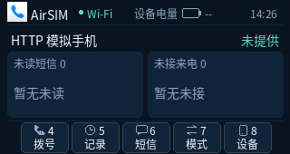
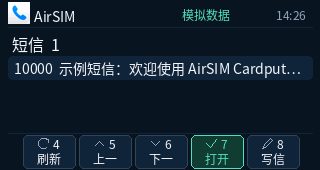
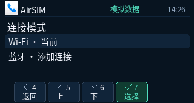
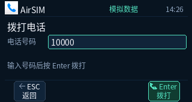

# AirSIM Cardputer

通过 **Wi-Fi 或蓝牙**连接运行 AirSIM 的安卓手机，在 M5Stack Cardputer Zero 上拨打和接听电话、收发短信、进行双向语音通话。

这是独立的 Cardputer 客户端，不是 AirSIM 官方发行版。本仓库不包含或修改原 AirSIM 安卓应用、iOS 应用及 Relay Worker。当前不提供云端连接模式。

- 当前应用版本：**0.3.13**；发行安装包：**0.3.13-1 / arm64**
- [下载安装包与演示视频](https://github.com/kai-wu-cortex/airsim-cardputer/releases/tag/v0.3.13-1)
- [商店首次上架审核 PR #325](https://github.com/CardputerZero/packages/pull/325) · 分享码 **ASCP**
- **上架状态：已提交，等待维护者人工审核。** 提交 PR 不代表已在商店上架。

## 界面

| 首页 | 短信 |
| --- | --- |
|  |  |

| 连接模式 | 拨号 |
| --- | --- |
|  |  |

截图与[旧版界面录屏](store/device-demo.mp4)来自真实 Cardputer Zero 的 framebuffer，使用隔离的模拟手机、示例号码和示例短信，不展示用户私人数据。录屏展示启动、短信操作、拨号界面、来电拒接、模式选择与退出；不会发起真实运营商通话。

[0.3.13 真实设备使用视频](https://github.com/kai-wu-cortex/airsim-cardputer/releases/download/v0.3.13-1/airsim-cardputer-0.3.13-real-device.mp4)由用户提供并授权公开，保留完整过程和原声，经过压缩用于商店人工审核。

## 功能

- Wi-Fi 自动发现、手动配对和已保存连接恢复；蓝牙 VoBLE 配对及签名重连。
- 拨号、接听、拒接、挂断、DTMF、麦克风静音和双向通话音频。
- Wi-Fi 事件触发收信、蓝牙新短信接收、发送短信及本机消息记录。
- 首页显示手机名称与号码、设备电量、未读短信正文和未接号码。
- SIM 选择、本地联系人、通话记录、短信本地删除。
- 统一的底部图标按键，支持中文显示；键盘输入英文、数字与符号。

完整范围与验证状态见 [FEATURE-PARITY.md](FEATURE-PARITY.md)。

## 设备要求与安装

需要 Cardputer Zero（Debian 13 ARM64、320×170 屏幕），以及一台运行 [AirSIM](https://github.com/kai-wu-cortex/AirSIM) 的安卓手机，或已配置 [AirSIM MU-300 插件](https://github.com/kai-wu-cortex/airsim-mu300) 的兼容设备（Wi-Fi）。请按原 AirSIM 的说明启用电话、短信、音频和蓝牙所需权限。

下载 Release 中的 `.deb`，在 Cardputer 上安装：

```sh
sudo apt install ./airsim-cardputer_0.3.13-1_arm64.deb
```

安装包使用系统 Python、Pillow、cryptography、zeroconf、evdev、Bleak、PipeWire 与 Noto CJK。应用从启动器打开，以普通用户 `pi` 运行；不要使用 `sudo airsim-cardputer`。安装不会新增开机后台服务。

商店审核通过后，可使用分享码 `ASCP` 查找应用。审核前请使用 GitHub Release 安装包。

## 连接手机

### Wi-Fi

1. 两台设备加入同一局域网，在手机 AirSIM 打开一次性配对。
2. Cardputer 首页按 **8 → 5**，自动发现设备；F/X 选择，6 连接。
3. 输入手机显示的六位码并确认。未发现时可按底部 **8 手动连接**，输入手机 IP、配对端口和六位码。这里不是 ADB 调试端口。

**新 Wi-Fi 配对会通过原 Android 本地配对协议，将手机切到本地模式并替换原云端注册。** 确认页会提示这一影响；恢复已有连接不会重新配对。

### 蓝牙

1. 手机开启 AirSIM VoBLE。
2. Cardputer 首页按 **8 → 6** 扫描并选择手机。
3. 核对双方六位配对码，再确认连接。

如果手机已有旧客户端密钥，而 Cardputer 没有对应凭据，需要先处理手机原配对设置。应用不会自动清除手机配对。

首页 **7** 切换 Wi-Fi / 蓝牙。通话期间禁止切换连接。

## 按键

| 页面 / 操作 | 按键 |
| --- | --- |
| 首页 | 4 拨号 / 通话，5 记录，6 短信，7 模式，8 设备 |
| 来电 | 4 或 Enter 接听，8 拒接 |
| 通话 | 4 静音，6 通话按键 / 重连声音，8 挂断 |
| 输入表单 | Tab 换字段；Enter 下一项 / 提交；数字键正常输入 |
| 通用 | 短 ESC 返回，长 ESC 退出到启动器 |
| 系统组合键 | fn+H 帮助，fn+J 截屏 |
| 非输入状态 | F/Z/X/C 对应上/左/下/右 |

Cardputer 发起或接听的电话接通后自动开启声音；手机本机接听的通话不会自动被接管。拨号页 Enter 会发起真实呼叫；发送短信需在确认页按 8。

## 通话音量

0.3.13 的 Wi-Fi 和蓝牙通话接入系统自带的 PipeWire / WebRTC 回声消除器：下行语音作为回声参考，麦克风先消回声、降噪，再增加 9 dB 有界补偿；播放增加 12 dB 有界补偿。系统音量、静音及默认设备不变，独立音频节点仅在通话中存在，结束后释放。处理保持 20 ms 网络帧，AEC 内部使用 48 kHz / 10 ms 块。2026-11-17 用户实测 MU-300 Wi-Fi 通话后反馈正常；这不是量化回声衰减或长时间稳定性报告。蓝牙 AEC 已通过实机模拟链路检查，听感未单独验收。

MU-300 Wi-Fi 呼出支持现有 `AIRSIMEM1` 早期音频协议：验证通话身份、签名与有效期，续期 30 秒租约；接通前只接收运营商实际音频，不打开麦克风、不计时，接通后切换到双向通话。没有运营商早期媒体信令时不会伪造提示音。蓝牙和其他设备的早期音频不在本次实现范围内。

回声消除启动失败会提示重新连接声音，不会悄悄退回未消回声的麦克风。依赖系统 `libpipewire-0.3-modules`、`libspa-0.2-modules` 和 `wireplumber`。[PipeWire 官方回声消除说明](https://docs.pipewire.org/1.2/page_module_echo_cancel.html)

## 收信与使用限制

Wi-Fi 收信使用现有 `/api/events` 与 `/api/sms` 接口，收到后立即保存到本机，并按消息身份去重。编辑或发送短信不会阻塞事件收信。

手机接口使用**共享交付队列**。如果其他客户端先 ACK，该消息就会从接口移除；Cardputer 无法补拉已移除的历史。事件收信缩短等待，但不能保证多个客户端都能收全。需要保证 Wi-Fi 收信时，请暂停其他客户端对同一手机的本地短信同步。

- 蓝牙接收连接期间的新短信事件，不同步手机全部历史短信。
- 未读和未接计数是 Cardputer 的本机记录；蓝牙未接统计依赖连接期间观察到的来电状态。
- 应用必须保持运行才能接收来电；退出后无后台提醒。
- 无中文输入法或 iOS 通讯录同步。
- 云端 / Relay 模式不在当前版本范围内。

## 配置与隐私

配置位于 `~/.config/airsim-cardputer/`：目录权限 0700，凭据与消息文件权限 0600。消息按手机身份隔离，最多保留 512 条。删除短信只影响本机记录，应用不会 ACK 或删除手机共享交付队列。

不要将该目录、配对密钥或真实短信截图提交到 GitHub。仓库内的示例截图、旧版界面录屏和测试凭据均为演示数据；Release 的实拍使用视频单独标注来源。

## 开发、测试和打包

推荐在 Debian 13 环境执行：

```sh
sudo apt update
sudo apt install python3 python3-pil python3-cryptography python3-zeroconf \
  python3-bleak python3-evdev pipewire-bin libpipewire-0.3-modules libspa-0.2-modules wireplumber \
  fonts-noto-cjk dpkg-dev git

git clone https://github.com/kai-wu-cortex/airsim-cardputer.git
cd airsim-cardputer
python3 -m unittest discover -s tests -v
python3 packaging/build.py
```

纯 Python 应用无需交叉编译。构建输出位于 `dist/`；ARM64 包依赖 Cardputer 端的系统组件，不能在任意桌面机器上直接运行硬件界面。

离线界面预览：

```sh
python3 -m airsim_cp.app --demo --render /tmp/airsim-preview.png
```

`--demo` 禁止拨号、发短信和配对操作。`tests/test_*.py` 使用隔离的 HTTP / 内存 GATT 对端；`tests/verify_*` 为设备诊断脚本，依赖现场目录、启动器及输入设备，不属于通用桌面测试。构建脚本打包当前文档；已公开的 Release 安装包不因后续文档更新而覆盖。

目前 **111 项自动回归通过**。0.3.13 已完成实机 PipeWire 双向链路、回声消除节点路由及退出释放检查，并获用户 MU-300 Wi-Fi 实测确认。真实蓝牙拨号、双向收听和短信送达，以及 0.3.11 Wi-Fi 新短信自动接收，已通过用户实测；其余模拟测试不等同于运营商实测。

## 商店发布流程

本仓库是**应用源码仓库**；`CardputerZero/packages` 是**商店目录与发行审核仓库**。

官方支持自行构建 `.deb` 后使用开发者门户或 `czdev publish --deb ...` 提交。它会托管安装包并在商店仓库创建审核 PR；新应用需要实机演示视频与人工审核。`app-builder.json` 的 `store.source_repo` 指向本源码仓库。[官方提交说明](https://cardputer.cc/#/documents/cp0-submit) · [官方元数据规范](https://github.com/CardputerZero/AppBuilder/blob/main/docs/APP_BUILDER_JSON.md)

官方 AppBuilder 还支持根据公开仓库在线构建，这是生成安装包的另一种方式；本项目目前使用自己的 `packaging/build.py` 打包，并不声称已接入通用 AppBuilder 在线构建工作流。

## 许可证

[PolyForm Noncommercial 1.0.0](LICENSE)，作者 Kyle。它是非商业使用许可，不是 MIT 许可证。原 AirSIM 图标保留原项目归属与必需声明，详见 [NOTICE](NOTICE) 与 [图标来源](assets/BRAND-SOURCE.md)。
